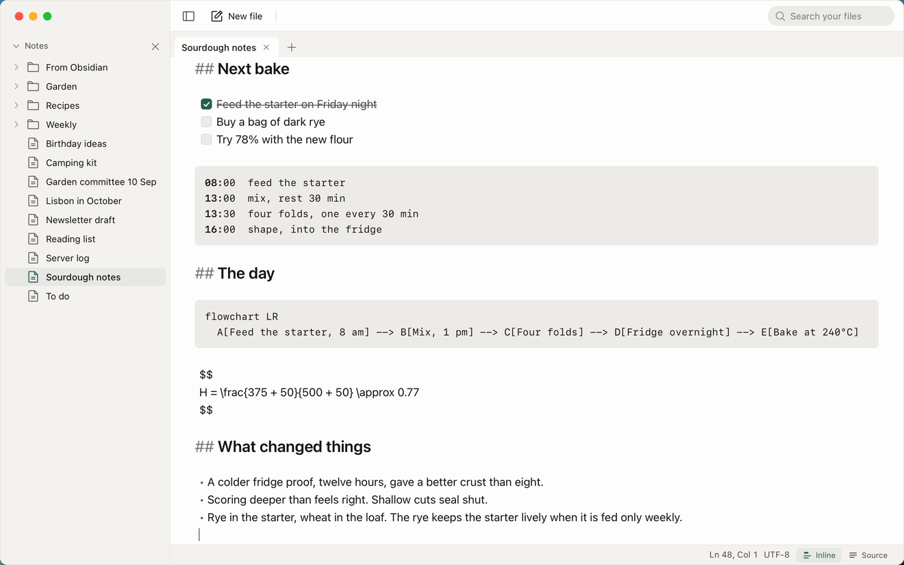

<div align="center">


# Jotra

Jotra is a text editor for macOS, Windows and Linux that opens any text file and searches every file in its folder. Markdown files render inline as you type, and connections, the graph, tags and chat are apps you switch on in Settings.

Jotra was called Writ through version 1.0.1.

[**Download**](https://github.com/ibrahemid/writ/releases/latest) · [**Website**](https://writ.ibrahemid.com)

</div>

<picture>
  <source media="(prefers-color-scheme: dark)" srcset="docs/media/hero-dark.gif">
  
</picture>

## Install

```sh
brew trust ibrahemid/writ                                            # macOS 12 or later
brew install --cask ibrahemid/writ/jotra
winget install -e --id ibrahemid.Writ                                # Windows
curl -fsSL https://github.com/ibrahemid/writ/raw/main/install.sh | sh # Linux
```

Or download a `.pkg` or `.dmg`, `.msi`, `.AppImage` or `.deb` from [Releases](https://github.com/ibrahemid/writ/releases/latest).

## The `jotra` command

The Windows installer and the `.deb` put it on your PATH, and `install.sh` puts it in `~/.local/bin`. On macOS or from a downloaded AppImage, install it from Settings, Integrations, Terminal command. `writ` runs the same command: the installers add both names, and the Settings action keeps a `writ` link that an earlier version made.

```sh
jotra todo.txt README.md                  # open files
jotra .                                   # open a folder
cargo test 2>&1 | jotra --title results   # save piped text as a file and open it
jotra new Groceries                       # create a file in Jotra's folder and print its path
jotra rename Groceries Shopping           # rename a file inside its folder
```

Every verb and its exit codes are in [docs/cli-verbs.md](docs/cli-verbs.md).

## Connected programs (MCP)

`jotra mcp` serves the files in Jotra's folder to MCP clients. Switch on Settings, Apps, Connected programs: under Connect a program, Add puts Jotra in Claude Code, Codex, Gemini CLI, Cursor, VS Code, LM Studio or Claude Desktop, Copy gives any other client the JSON, and Test reports how many tools Jotra lists. A program's first call waits until you approve reading, or reading and writing. Jotra never edits another program's configuration file. A program added under the server name `writ` keeps that name and the tool `open_in_writ`.

```sh
claude mcp add --scope user jotra -- "/Applications/Jotra.app/Contents/MacOS/jotra" mcp
```

The walk-through is in [Connect a program to your folder with MCP](https://writ.ibrahemid.com/guides/agent-output/), and Claude Code's hooks are in [docs/integrations/claude-code.md](docs/integrations/claude-code.md).

## Build from source

Prerequisites: [rustup](https://rustup.rs), which installs the Rust version `rust-toolchain.toml` pins, Node.js `^22.22.2 || ^24.15.0 || >=26`, pnpm 9+, and the [Tauri v2 prerequisites](https://tauri.app/start/prerequisites/) for your OS.

```bash
git clone https://github.com/ibrahemid/writ.git jotra
cd jotra
pnpm install
cargo build -p jotra-cli
HOST_TRIPLE=$(rustc -vV | sed -n 's/^host: //p')
scripts/stage-cli-sidecar.sh target/debug/jotra "$HOST_TRIPLE"
pnpm tauri dev
```

On Windows PowerShell, after `pnpm install`:

```powershell
cargo build -p jotra-cli
$hostTriple = (rustc -vV | Select-String '^host: ').Line -replace '^host: ', ''
(Get-Content src-tauri/tauri.conf.json -Raw | ConvertFrom-Json).bundle.externalBin |
  ForEach-Object { Copy-Item target/debug/jotra.exe "src-tauri/$_-$hostTriple.exe" }
pnpm tauri dev
```

For a release build, build the sidecar with `cargo build -p jotra-cli --release`, stage `target/release/jotra` (or `jotra.exe`) the same way, and run `pnpm tauri build`. The installer or app bundle is written to `target/release/bundle/`.

[docs/ARCHITECTURE.md](docs/ARCHITECTURE.md) covers the system design and [docs/adr/](docs/adr/) the decision records.

## License

MIT. See [LICENSE](LICENSE).
